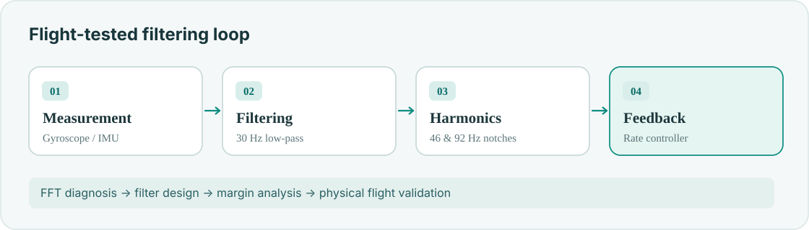
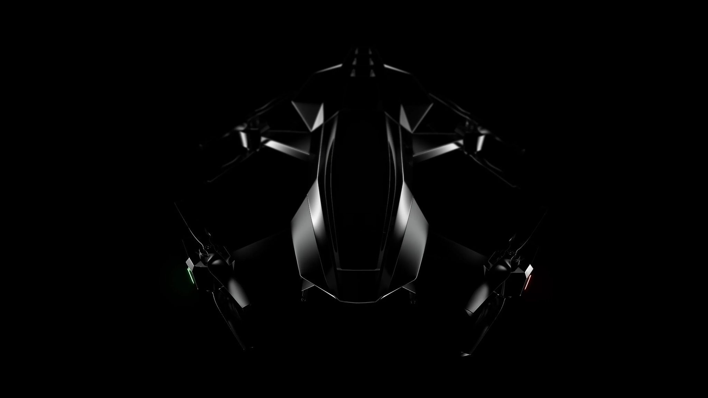

**AIAA SciTech 2026 · [Published paper (PDF)](/assets/pdf/aiaa2026_fft.pdf)**

Rotor vibration corrupted angular-rate feedback on a 250 kg coaxial eVTOL. I traced the dominant frequencies and evaluated **digital filtering without compromising loop stability**.

## Method

- **Diagnosis:** FFT/PSD analysis identified harmonics near 46 and 92 Hz.
- **Design:** 30 Hz low-pass and dual-notch filters.
- **Validation:** phase delay, gain/phase margins and hover telemetry.

## Physical validation

<figure><figcaption>Aircraft used for flight experiments</figcaption></figure>
<figure><figcaption>Original full-scale aircraft photo</figcaption></figure>

**Outcome:** Substantially reduced vibration harmonics and throttle variation, with repeatable stable hover. Full quantitative results appear in the [paper](/assets/pdf/aiaa2026_fft.pdf).
