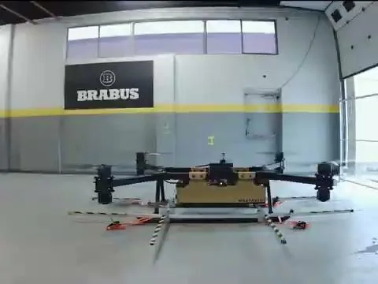

**Publication:** [AIAA SciTech 2026 · Full paper (PDF)](/assets/pdf/aiaa2026_fft.pdf)  
**Scope:** FFT-guided filter design, real-aircraft hover experiments, stability and latency analysis

## Why a filtering problem became a flight-control problem

During early testing of a large coaxial eVTOL, rotor-induced vibration contaminated the IMU feedback used by the flight-control system. The controller can interpret vibration as actual angular motion and respond with unnecessary actuator commands. Adding mechanical damping was not automatically the solution: the design needed to reduce vibration without sacrificing controllability or introducing damaging phase lag.

I approached the issue through flight-data analysis, frequency-domain diagnosis, controlled parameter changes and repeated physical tests.

## Identifying the disturbance

The workflow began with recorded gyro and actuator data. FFT and power-spectral-density analysis revealed dominant blade-passage components around **46 Hz**, with a harmonic near **92 Hz**. Those narrowband peaks suggested targeting the offending frequencies instead of simply lowering the entire sensor bandwidth.

The final flight-tested chain used:

1. A second-order **30 Hz Butterworth low-pass filter** to reduce high-frequency content.
2. IIR notch filters centered at approximately **46 Hz and 92 Hz** to suppress rotor harmonics.
3. Closed-loop margin and latency analysis before evaluating the filtered configuration in hover.

The key trade-off was that attenuation is not free: every filter contributes phase delay in the feedback path, so the resulting controller had to be assessed as a complete system.

## Experimental comparison

Indoor hover experiments compared the unfiltered baseline, mechanical isolation and digitally filtered configurations. The published paper reports:

| Measurement | Reported result |
| --- | --- |
| Angular-rate harmonic power | **33.6 ± 0.97 dB** reduction |
| Total harmonic RMS angular rate | **98%** reduction |
| Throttle standard deviation | **60 ± 10%** reduction |
| Hover endurance in the evaluated setup | Repeatable **11-minute** stable hovers |

The paper also reports approximately **16 ms** of additional filtering delay and evaluates its impact on the modeled roll-rate loop's stability margins.

*Indoor test platform used during the stabilization and vibration-mitigation work.*

## What this demonstrated

The important result was not just a quieter gyroscope. It was a repeatable, weight-neutral way of improving the feedback signal while retaining adequate control-loop margins on a full-scale aircraft. The engineering workflow—**observe, identify, design, verify the loop, and then flight-test**—is reusable well beyond this particular filtering issue.

**Read:** [Flight-Validated Digital Filtering for Vibration Mitigation on a 250 kg eVTOL](/assets/pdf/aiaa2026_fft.pdf).
