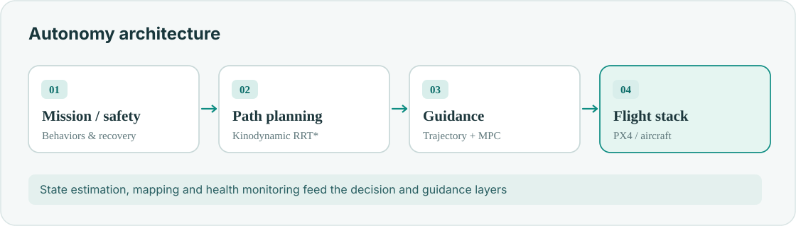
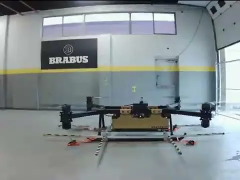
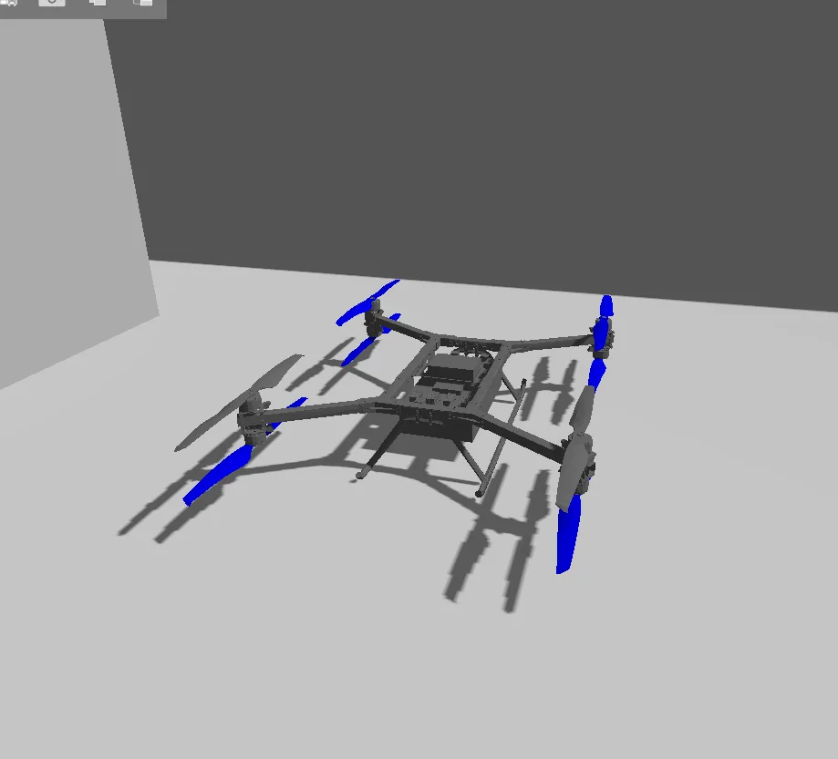
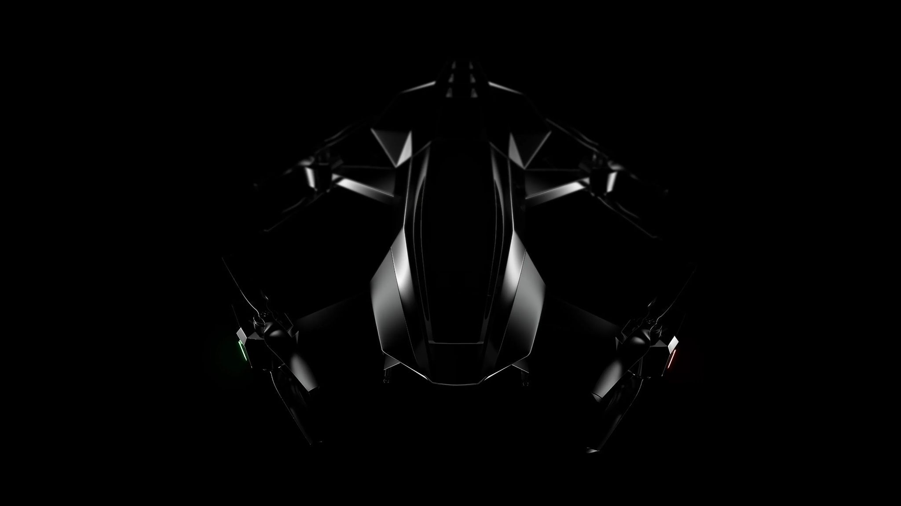

**Mostavio · Robotics Software Engineer · 2023–present**  
ROS 2 · C++ · Python · PX4 · Gazebo · Jetson

I lead the autonomy integration for a heavy-lift eVTOL. The challenge is making planning, sensing and safety work together on an aircraft where every real-world test matters.

## System architecture

- **Mission execution:** behaviors, safety gating and recovery.
- **Navigation:** 3D RRT*, trajectory optimization and constrained guidance.
- **Estimation:** stereo VO, GNSS/RTK, UWB and LiDAR fusion.
- **Flight testing:** custom flight-deck software, telemetry and post-flight analysis.

## From simulation to aircraft

<figure><figcaption>Full-scale aircraft during flight testing</figcaption></figure>
<figure><figcaption>Aircraft model for SITL/HITL validation</figcaption></figure>
<figure><figcaption>Aircraft photograph retained from the original portfolio</figcaption></figure>

**Validation:** More than 1,500 subscale flights and 100 full-scale tests documented in my CV.

Related work: [planning & MPC](/projects/motion-planning-mpc/) · [estimation](/projects/state-estimation-localization/) · [flight-tested filtering](/projects/flight-testing-filtering/).
