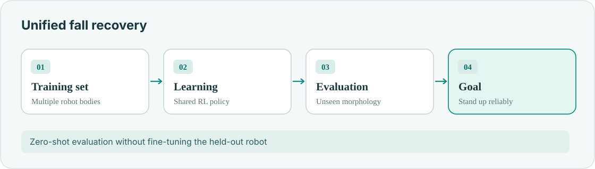
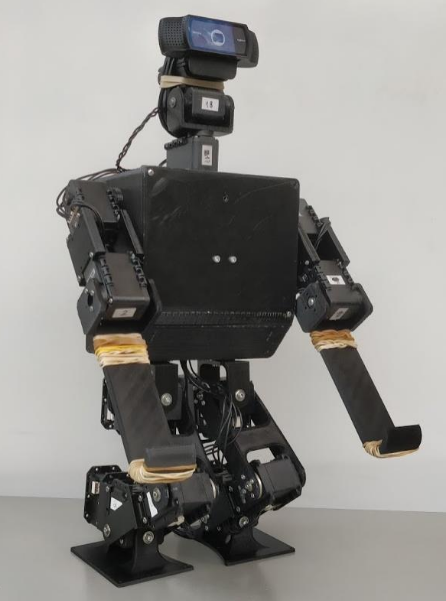

**RoboCup Symposium 2025 · [Paper (PDF)](/assets/pdf/robocup2025.pdf)**

Can one learned controller recover from falls on **different humanoid bodies**, including robots it has never trained on?

## Shared policy

- Trained a shared RL recovery policy across seven morphologies.
- Evaluated unseen robots **without fine-tuning**.
- Reached up to **86 ± 7%** zero-shot recovery success in reported experiments.

## Recovery examples

<figure><figcaption>Forward-fall recovery demonstration</figcaption></figure>
<figure><figcaption>Backward-fall recovery demonstration</figcaption></figure>
<figure><figcaption>Robot model retained from the original portfolio</figcaption></figure>

The paper investigates where morphology-blind policies generalize and where they still fail.
