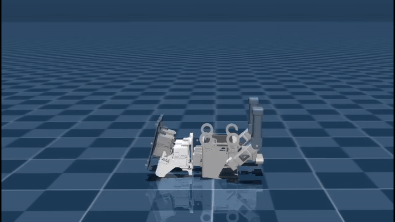
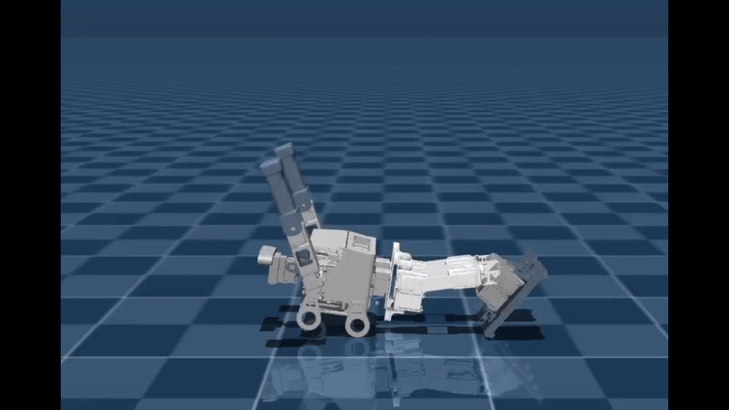

**Paper:** [RoboCup Symposium 2025 (PDF)](/assets/pdf/robocup2025.pdf)  
**Code and benchmark:** [unified-humanoid-getup on GitHub](https://github.com/utra-robosoccer/unified-humanoid-getup)

## One recovery controller for multiple humanoid bodies

Humanoid robots fall in competition and during exploration. A robot that cannot get up is effectively out of service, but conventional recovery sequences are often designed or trained separately for each platform.

My research asks whether **a single reinforcement-learning policy can recover from falls across different humanoid morphologies, including robots that were not present in training**.

## A shared policy, not seven independent solutions

I created a MuJoCo evaluation suite spanning seven humanoid models, from approximately **0.48 m to 0.81 m** tall. The training setup uses a common observation and action interface, morphology-agnostic reward terms, and the CrossQ algorithm.

Instead of passing an explicit morphology embedding to the policy, the study evaluates a **morphology-blind** approach. This makes the generalization question more demanding: the recovery strategy has to be inferred from ordinary observations.

## Experiments and evaluation

The paper investigates:

- Leave-one-morphology-out testing, with the held-out humanoid evaluated without fine-tuning.
- How the diversity and scale of training morphologies affect generalization.
- Where a single shared policy matches or surpasses robot-specific recovery baselines.
- Failure cases in recovery from different fall conditions.

The strongest reported result reaches **86 ± 7%** zero-shot recovery success on unseen morphologies; individual performance varies with the held-out robot and experimental condition.

## Recovery sequences

*Front-fall recovery sequence from the supplied research portfolio.*

*Back-fall recovery sequence from the same evaluation suite.*

## What the project contributes

The contribution is not a single impressive animation; it is the experimental evidence that a shared controller can generalize across a controlled range of robot bodies. The paper also identifies limits to that transfer.

Read the [paper](/assets/pdf/robocup2025.pdf) for confidence intervals, the robot-specific comparisons and ablations. Earlier work on learned humanoid skills is available in my [undergraduate thesis project](/projects/sim2real-soccer/).
