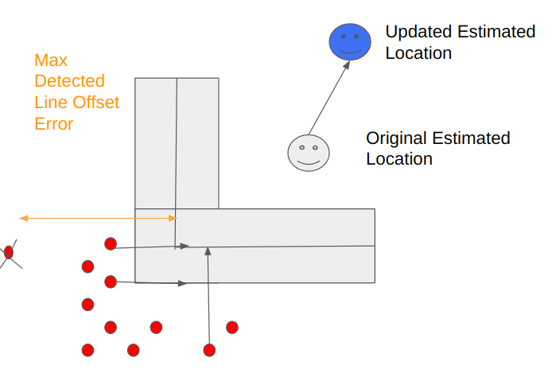
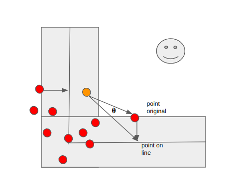

**UTRA RoboSoccer · 2022–2023**  
**Tools:** ROS, OpenCV, camera projection, geometric registration, unscented Kalman filter

## Why field lines?

A humanoid soccer robot has wheel-free, noisy odometry and cannot assume reliable global positioning. The painted field provides a map of known geometry, but the camera sees **white pixel regions**, not a direct position measurement. I designed a localization procedure that turns those detections into field-relative corrections and combines them with motion estimates.

## Turning pixels into geometric observations

The vision subsystem isolates the white field lines and projects detected points onto the ground plane in the robot frame. The resulting set of points is compared with a known model of the field markings.

Rather than trying to match just two line endpoints, the method asks how closely **each observed point** aligns with a valid map line, ignoring outliers or ambiguous matches where appropriate.

*Original project figure: projected points compared against nearby geometric lines.*

## Estimating a correction in position and heading

For translation, the differences between matched points and the field map provide a correction in the ground plane. Heading is more difficult: a rotation changes the fit of the entire point set, and the original implementation estimates a mean angular correction based on point-to-line projections.

*Original diagram illustrating the rotation correction calculation.*

These steps produce a measurement of the field-relative pose, represented as a correction in x, y and heading. The technique depends on adequate line visibility and on rejecting correspondences that are not geometrically meaningful.

## Fusing visual localization with odometry

I used an **unscented Kalman filter (UKF)** with:

- **Prediction:** propagate the pose estimate using robot motion and odometry.
- **Correction:** update that estimate from the field-line registration measurement.
- **Covariance:** represent uncertainty in motion and vision and evaluate its consistency against measured error.

The legacy experiments tuned covariance values with attention to whether ground-truth error stayed within roughly one standard deviation of the estimator's stated uncertainty.

## What the experiments showed

The project exposed the difference between an accurate-looking track and a statistically consistent estimator. Incorrect data association, overconfident visual measurements, and orientation error can destabilize the pose estimate even when the detector sees many lines.

[Watch the original localization demonstration](https://drive.google.com/file/d/1JxMgp_nBoYYWKC2NnRFqYc-xffr35isx/view).

**Related:** [Field-line perception details](/projects/legacy-5-robosoccer-fieldline/) · [RoboCup software project](/projects/robocup-software/) · [Multi-sensor state estimation on eVTOL](/projects/state-estimation-localization/).
