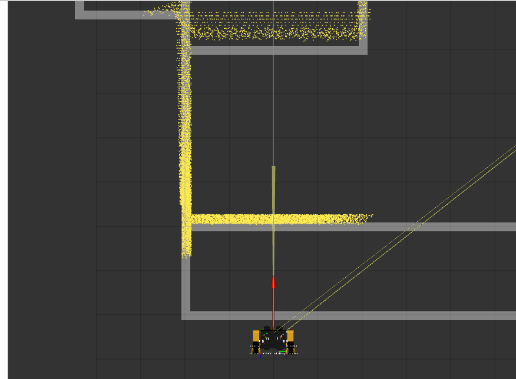

**UTRA RoboSoccer · Original work 2020**  
**Tools:** Python, ROS, OpenCV, camera geometry

## A line is more than two endpoints

A standard line detector may fit a segment with two endpoints, but the painted soccer markings occupy a real area in the camera image. Close to the line, ignoring its width discards geometric information that could help localization.

I developed a field-perception pipeline that preserves these line regions and converts them into a set of points in the robot's ground plane.

## Image processing

The legacy implementation first isolated the playing field using a horizon or region-of-interest constraint. Thresholding and morphological operations reduced irrelevant pixels and small holes, leaving the field-line regions for projection.

## From the camera to the robot frame

Detected image points were projected onto the ground surface using a calibrated pinhole camera model and the known camera-to-ground geometry. In a conventional camera model, a point at depth Z satisfies the proportional relationship

\[
\begin{bmatrix}u\\v\\1\end{bmatrix}
\sim K\begin{bmatrix}X/Z\\Y/Z\\1\end{bmatrix}.
\]

The project then represents observations in the robot frame, where they can be compared to a map of painted field lines. The original project modeled the field-line width at **0.025 m**.

*Original RViz visualization of extracted points transformed into a ground-plane representation.*

## Connecting perception to estimation

The point cloud supplies the map correspondence data for [the field-line UKF localization pipeline](/projects/legacy-3-robosoccer-ukf/). Poor segmentation or erroneous camera calibration does not stay isolated inside perception—it affects the robot's estimated position.

[Watch the field-line detection demonstration](https://youtu.be/JwFqQIDc-Jc).

This was an early example of a design theme that runs through my later work: **the perception representation must be chosen for the decision or estimator that consumes it**.
