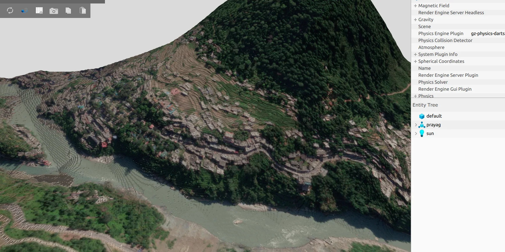

**Role:** Navigation and control software, Mostavio  
**Tools:** ROS 2, C++/Python, CVXPY, quadratic programming, NVIDIA nvblox, PX4

## From an obstacle-free path to something an aircraft can actually fly

Finding a geometric route around an obstacle is only the beginning. A heavy multirotor still needs to follow that route while respecting its dynamics, braking distance, sensor delays, available acceleration and the behavior of its existing flight controller.

I developed a layered motion-planning and tracking workflow so that each stage makes a specific promise to the next.

## 1. Planning with vehicle constraints

The global planner uses **3D kinodynamic RRT*** to account for vehicle motion while exploring feasible routes. This is more useful than treating each tree edge as an instantaneous straight-line translation when the aircraft has finite velocity and maneuvering limits.

A global path is a starting point, not yet a command trajectory. It is converted into an ordered sequence of waypoints for smoothing and tracking.

## 2. Generating a smooth flight reference

I use **minimum-snap polynomial trajectory optimization** to generate a continuous, smooth reference from those waypoints. Differential-flatness concepts connect the resulting position derivatives to the guidance quantities needed downstream.

The reason to optimize snap is not aesthetic smoothness: discontinuous or excessively aggressive commands can expose actuator limits and cause tracking problems near corners.

## 3. Tracking with constrained MPC

A **3D model predictive controller** solves a quadratic optimization problem over a finite horizon, balancing reference-tracking error against control effort and changes in commanded inputs.

Its constraints limit velocity, acceleration and command-rate demands. The high-level controller produces references for PX4, leaving inner-loop attitude stabilization and allocation to the existing flight stack. A practical implementation must also handle infeasible constraints, delays and model mismatch.

## 4. Reacting to mapped obstacles

Stereo reconstruction and NVIDIA **nvblox ESDF** mapping supply obstacle-distance information for local guidance. Collision avoidance is integrated with the tracking problem rather than applied solely as a geometric path adjustment.

*Simulation and mapping environments provide repeatable scenarios for integration testing.*

## What I validate

- Whether planned trajectories remain feasible as speed or turn curvature increases.
- Tracking lag, overshoot and braking behavior around waypoints and tight curves.
- The effect of localization delay and changing obstacle geometry.
- Constraint activation, solver behavior and safe recovery when the preferred trajectory cannot be executed.

For the complete aircraft integration, see [heavy-lift eVTOL autonomy](/projects/heavy-lift-evtol-autonomy/). The site also preserves my [earlier RRT* and trajectory-rollout experiments](/projects/legacy-6-rob521/) as a record of how I developed this work.
