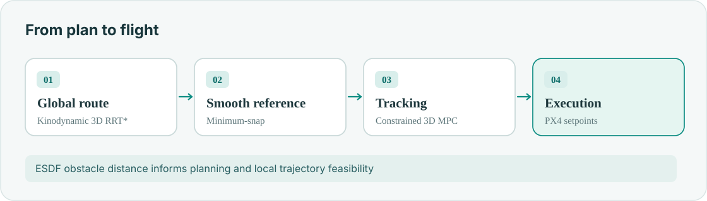
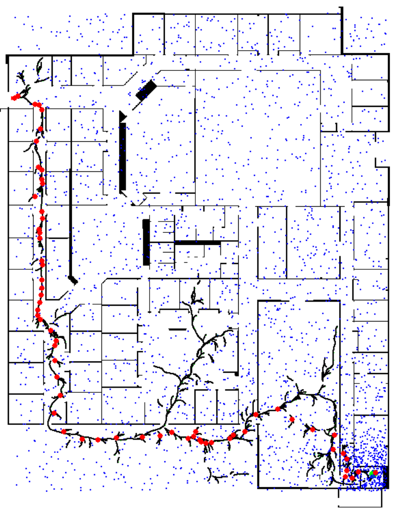

**Mostavio · Navigation & guidance software**  
3D RRT* · Minimum-snap · CVXPY / QP · MPC · nvblox ESDF

A route around obstacles is not enough: the aircraft must be able to **follow it** with finite acceleration, braking distance and sensor latency.

## Navigation pipeline

- **Plan:** kinodynamic RRT* generates feasible global paths.
- **Smooth:** minimum-snap optimization provides a continuous reference.
- **Track:** constrained MPC computes flight-guidance commands.
- **Avoid:** ESDF obstacle distance informs replanning and local constraints.

## Development environments

<figure><figcaption>Terrain-based navigation simulation</figcaption></figure>
<figure><figcaption>RRT* planning from my earlier ROB521 work</figcaption></figure>

**Engineering focus:** corner tracking, braking overshoot, latency, obstacle clearance and solver feasibility.
