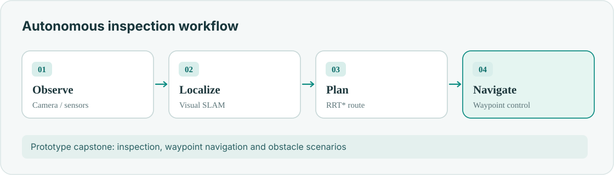
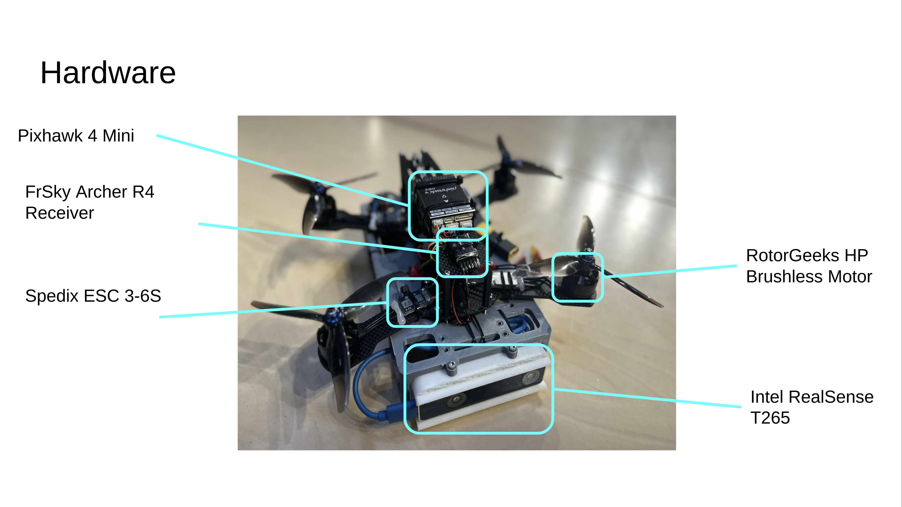
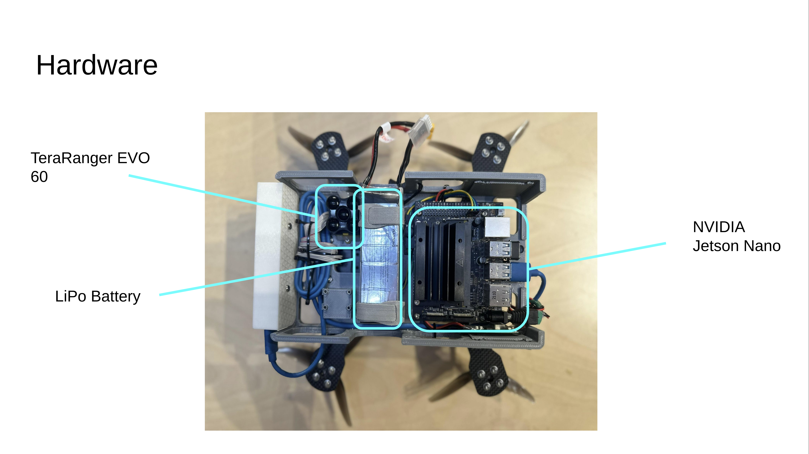
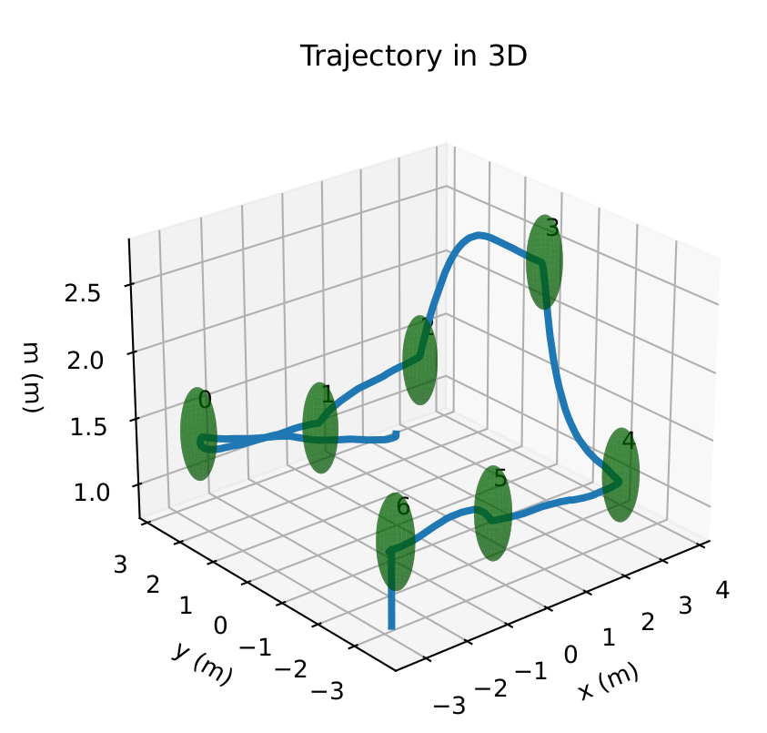
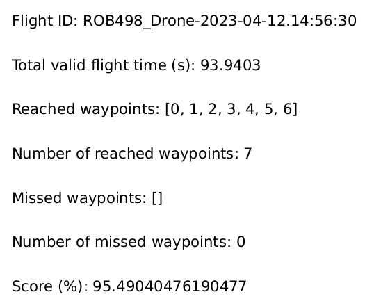

**University of Toronto · Engineering Science capstone · 2023**

We designed an inspection-drone prototype to reduce manual exposure in hazardous environments. My focus was integrating **perception, localization and autonomous navigation**.

## Inspection architecture

- YOLOv5 detection for inspection targets.
- Visual SLAM for navigation state.
- RRT* for waypoint routing and obstacle handling.

## Hardware and simulation

<figure><figcaption>Original assembled inspection-drone hardware</figcaption></figure>
<figure><figcaption>Second hardware configuration</figcaption></figure>
<figure><figcaption>Waypoint-navigation experiment</figcaption></figure>
<figure><figcaption>Obstacle-avoidance experiment</figcaption></figure>

Watch the original [hover](https://youtu.be/8mcuc0-HUeY), [waypoint](https://youtu.be/pLiu4lUnUiU) and [obstacle](https://youtu.be/VCbzIF69IFw) demonstrations.
