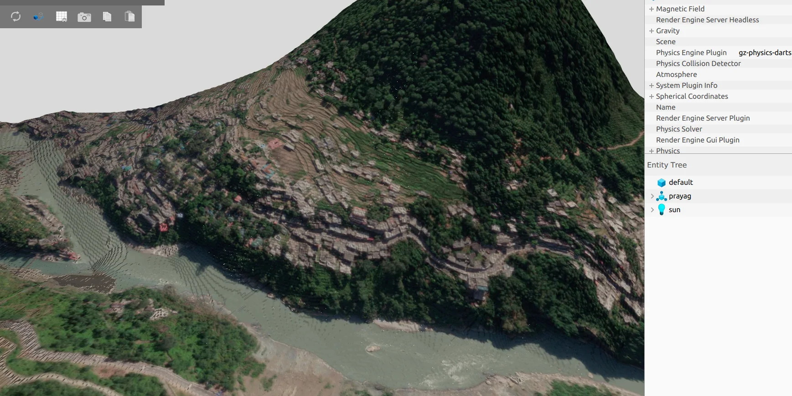

The control envelope of a heavy-lift aircraft changes with loading. A controller that works well in one configuration must also respect the reduced control authority available in another.

## Engineering question

How can a high-level trajectory-tracking controller account for changing vehicle characteristics **without replacing the existing low-level flight controller**?

I have been exploring the integration of model-based guidance, online state/parameter estimation, constrained trajectory tracking, and realistic simulation. The design separates an outer-loop motion controller from the aircraft's attitude stabilization and actuator allocation.

## System integration

- **Dynamics and identification:** Use measured aircraft characteristics to make simulation and guidance assumptions more realistic.
- **Planning and guidance:** Connect generated flight paths to feasible commands that respect velocity and acceleration constraints.
- **Flight stack:** Integrate ROS 2 guidance with PX4 and evaluate through SITL/HITL workflows.
- **Validation:** Examine tracking quality, uncertainty, constraints and failure conditions before proposing changes for physical testing.

This page describes the engineering direction only. **Unreleased manuscripts, detailed results, figures and evaluation data are intentionally not published.**

For published flight-control work, see [flight-validated vibration filtering](/projects/flight-testing-filtering/).
