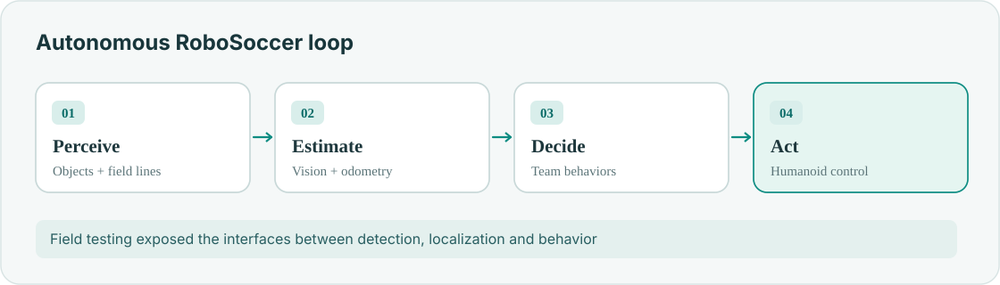
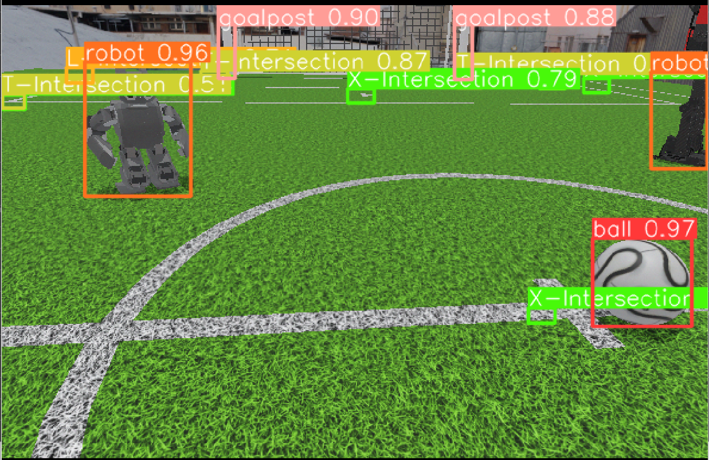
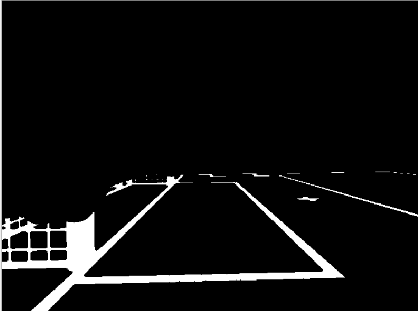
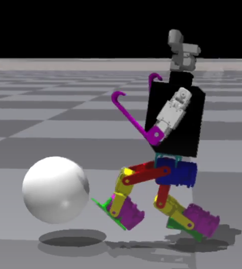
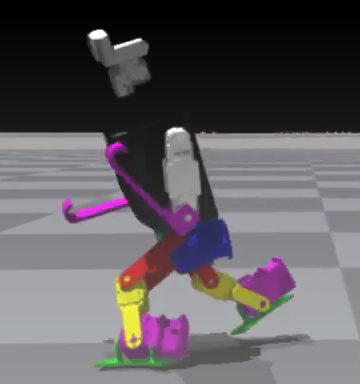

**Software Team Lead · UTRA RoboSoccer · 2019–2023**

I led a roughly 30-person software team building the perception, localization and behavior stack for autonomous humanoid soccer. The team placed **4th at RoboCup 2023**.

## From camera to action

- **Vision:** YOLO-based ball, goal and robot detection.
- **Localization:** projected field lines and an unscented Kalman filter.
- **Behavior:** robot and team-level decision logic.

## Original project media

<figure><figcaption>Object detection on a soccer field</figcaption></figure>
<figure><figcaption>Field-line perception</figcaption></figure>
<figure><figcaption>Humanoid kicking experiments</figcaption></figure>
<figure><figcaption>Humanoid walking experiments</figcaption></figure>

Technical details: [field-line detection](/projects/legacy-5-robosoccer-fieldline/) · [UKF localization](/projects/legacy-3-robosoccer-ukf/).
