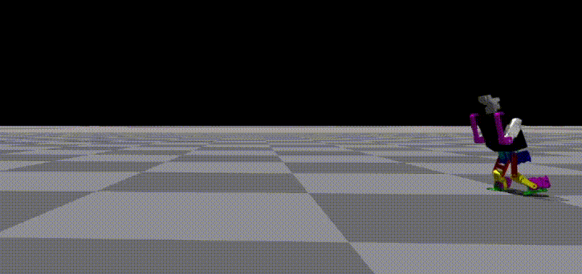
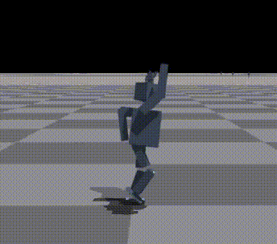

**BASc thesis:** *Sim2Real Reinforcement Learning for Soccer Skills* · April 2023  
**Supervisor:** Prof. Michael Guerzhoy · [Read the thesis (PDF)](/assets/pdf/thesis_2023.pdf)

## Why study learned soccer skills?

Classical humanoid motion routines can be effective, but building and tuning separate controllers for every contact-rich behavior takes significant engineering effort. My undergraduate thesis examined whether reinforcement learning and imitation learning could develop more flexible **walking, kicking and jumping** policies in simulation and then transfer those policies to a physical robot.

The research used PPO, curriculum learning and **Adversarial Motion Priors (AMP)**, with simulation environments including NVIDIA Isaac Gym and Webots.

## Training architecture

The learning setup combined an observation space, an action policy, task objectives and a motion-prior signal. Curriculum design gradually exposed the policy to more demanding versions of each task.

*The original thesis overview, preserved from the academic portfolio.*

The AMP component encouraged motions similar to reference examples while the task reward optimized soccer-relevant outcomes. This was important for contact-rich behaviors where a purely hand-designed reward can lead to mechanically successful but unnatural movement.

## Three learned skills

### Kicking

The policy had to combine balance, contact timing and a directed swing rather than maximizing a single joint movement.

### Walking

Walking required repeated balance and support transitions, with domain randomization used to explore robustness to changes in the simulated dynamics.

### Jumping

Jumping introduced a different contact sequence: loading, flight and landing.

## Evaluation and the reality gap

The policies demonstrated improved simulated behaviors, but the **transfer to the physical humanoid was unsuccessful**, as documented in the thesis abstract. This limitation is as important as the simulated results: contact modeling, actuation dynamics, sensing, and timing can prevent a policy that works in a simulator from working on hardware.

*Results figure retained from the thesis-era portfolio.*

I carried those lessons forward into more general humanoid learning research, including [the unified zero-shot fall-recovery policy](/projects/humanoid-zero-shot-getup/).
