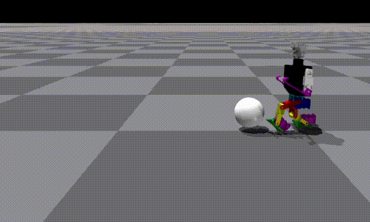
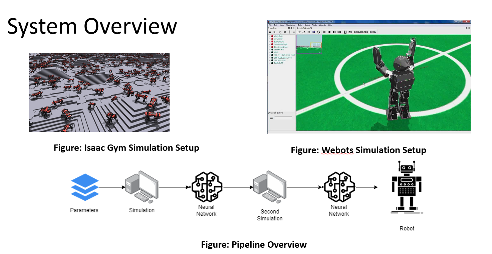
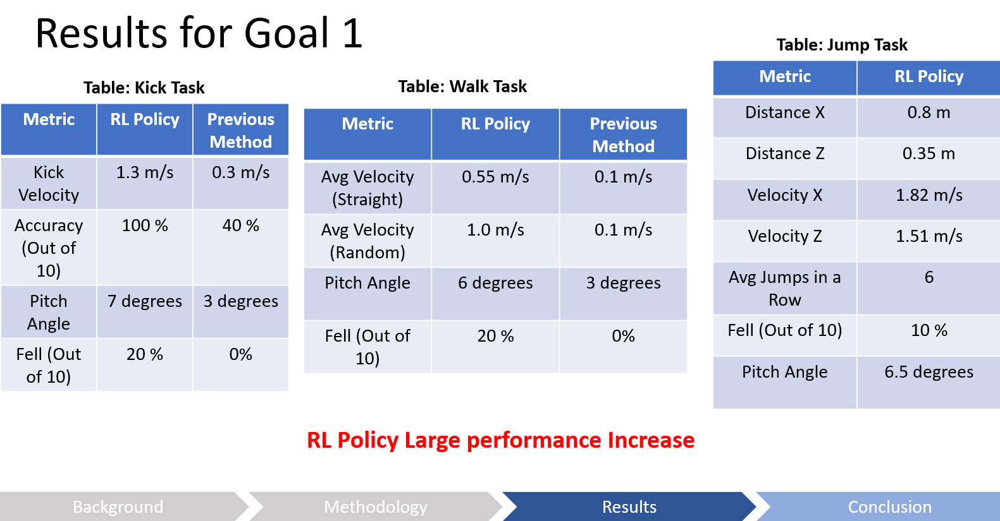

**BASc Thesis · University of Toronto, 2023 · [Full thesis (PDF)](/assets/pdf/thesis_2023.pdf)**

I explored how reinforcement and imitation learning can create humanoid soccer skills with less hand-tuned motion programming.

## Approach

- **PPO** for policy optimization.
- **Adversarial motion priors** to encourage reference-like motion.
- **Curriculum and domain randomization** for robust training.

## Skills from the original portfolio

<figure><figcaption>Walking policy</figcaption></figure>
<figure><figcaption>Kicking policy</figcaption></figure>
<figure><figcaption>Jumping policy</figcaption></figure>
<figure><figcaption>Original thesis system overview</figcaption></figure>
<figure><figcaption>Original thesis results slide</figcaption></figure>

**Result:** Promising behaviors in simulation; physical sim-to-real transfer was **not successful**. The gap informed my later [cross-morphology recovery work](/projects/humanoid-zero-shot-getup/).
