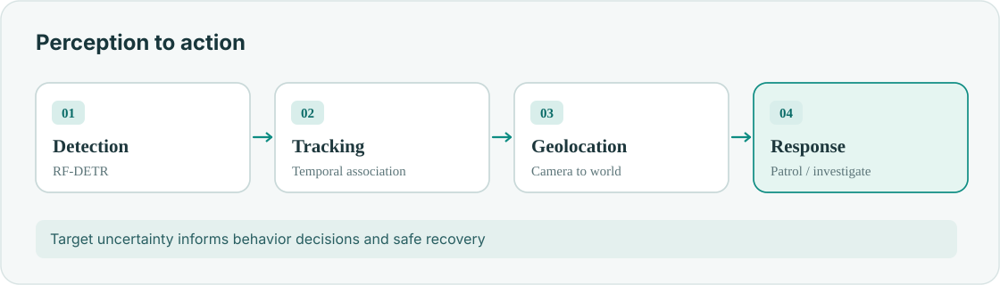

**Mostavio / Skyguard · ROS 2 · RF-DETR · Tracking · Camera geometry**

A detection is useful only if the aircraft can **track it, locate it and decide what to do**.

## Perception to action

- **Perception:** object detection and persistent target tracking.
- **Geolocation:** pixel-to-world geometry using camera and vehicle state.
- **Behaviors:** patrol, watch, investigate, follow and recovery.
- **Safety:** account for uncertainty and missing observations before acting.

## Operational viewpoint

<figure><figcaption>Aerial monitoring scene from the portfolio</figcaption></figure>

This overview shows software architecture without releasing customer-specific site data.
