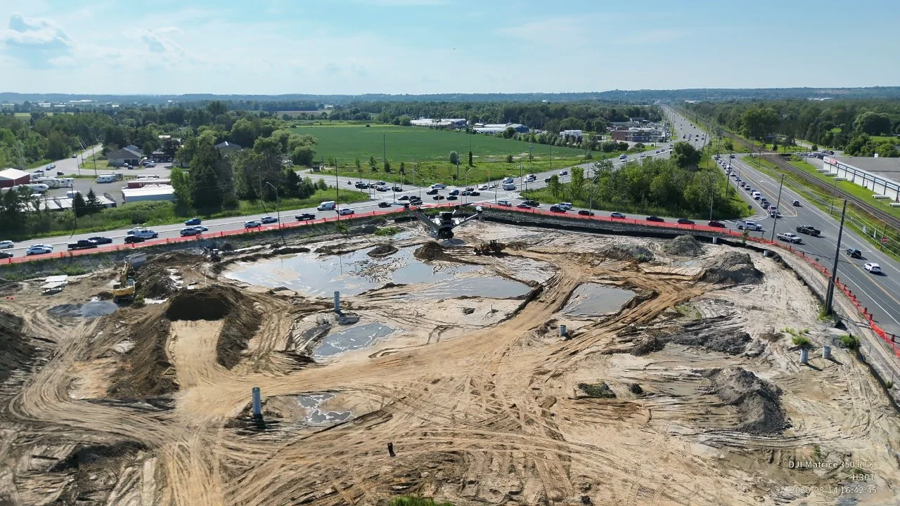

**Role:** Autonomy, perception and localization software · Mostavio / Skyguard  
**Stack:** ROS 2, RF-DETR, multi-object tracking, camera geometry, autonomous behaviors

## Making aerial perception actionable

A detector can identify a person or object in an image, but an autonomous site-security aircraft needs much more: a persistent target estimate, a location in a useful coordinate system, and a decision about what to do next.

My work on the Skyguard autonomy stack brings those pieces together, connecting camera observations to site-monitoring behaviors.

## Perception: detections to tracked targets

The perception pipeline uses object detection with RF-DETR and temporal association to maintain identities across consecutive camera frames. Tracking matters because flight motion and occlusion make raw detections intermittent; mission decisions should not restart every time a bounding box briefly disappears.

## Geometry: pixels to positions

Using camera calibration, vehicle state and projection geometry, the system estimates target locations in the operating frame. The accuracy depends on height, attitude, camera alignment and timing. I integrated these conversions with filtering and tracking so follow-up behaviors receive more stable position estimates.

*Site-security imagery from the supplied portfolio materials.*

## Behavior and mission execution

The system coordinates reusable actions such as **patrol, investigate, watch and follow**, with mission logic controlling when behaviors begin, update or terminate. This gives the autonomy software a place to handle interruptions, missing targets, safety constraints and operator intervention.

## The engineering lesson

The most important challenge is the interface between perception and action: uncertainty in a target estimate must be reflected in vehicle behavior. This page describes publicly shareable architecture only; operational customer details and deployment-specific data are excluded.

For related foundations, see [RoboCup perception](/projects/robocup-software/) and [state estimation](/projects/state-estimation-localization/).
