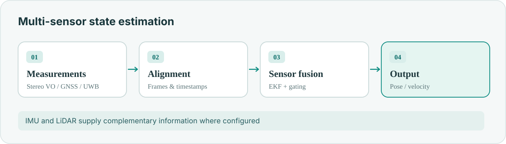
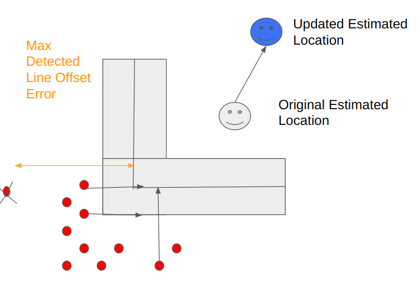
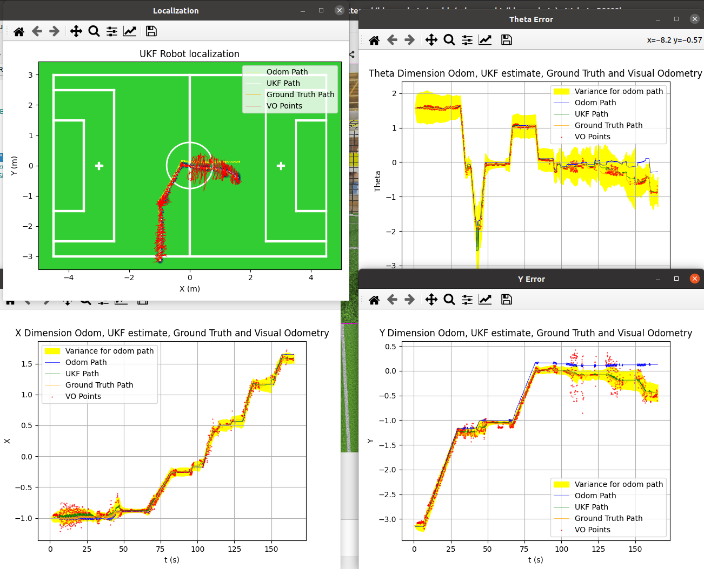

**Mostavio · ROS 2 · EKF · Stereo VO · GNSS/RTK · UWB · LiDAR**

A planning algorithm can only be as reliable as the state estimate it receives. My estimation work focuses on **coordinate frames, sensor timing, covariance and failure handling**.

## Fusion pipeline

- Align measurements in space and time.
- Fuse complementary observations through an EKF.
- Reject inconsistent data and monitor filter innovations.
- Publish state estimates for guidance and flight control.

## Foundations from RoboSoccer

<figure><figcaption>Field-point correspondence for visual localization</figcaption></figure>
<figure><figcaption>Legacy UKF localization results</figcaption></figure>

The same ideas—geometry, uncertainty and observable failures—connect my [earlier humanoid UKF](/projects/legacy-3-robosoccer-ukf/) to modern aerial sensor fusion.
